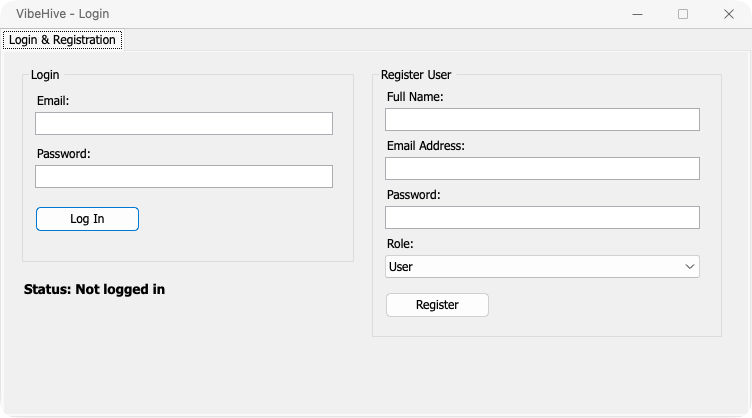
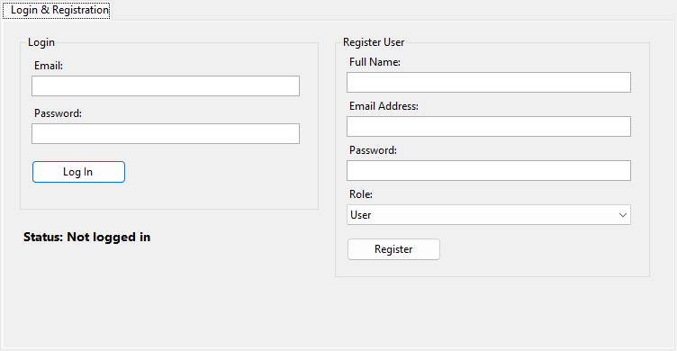

# Mac WinForms

Run existing C# WinForms projects as native macOS apps using the stock .NET SDK and a lightweight AppKit compatibility layer.

## Install and run in VS Code

1. Install the [.NET SDK for macOS](https://dotnet.microsoft.com/download) (8 or newer). You also need Python 3 and the Xcode Command Line Tools (`xcode-select --install`). For a project targeting .NET 9 or later, install its matching SDK and runtime.
2. [Download the VS Code extension](https://github.com/karilaa-dev/mac-winform/releases/latest/download/mac-winform.vsix). In VS Code, press **⌘⇧P**, choose **Extensions: Install from VSIX…**, and select the downloaded file.
3. Open your WinForms project folder. Press **⌘⇧P** and choose **Mac WinForms: Run Project**.

To debug, install Microsoft's C# extension, press **F5**, and choose **Mac WinForms**.

## Use the command line

From a clone of this repository, run the included gallery or point the launcher at your own project.

```sh
./bin/mac-winform run tests/Gallery
./bin/mac-winform run /path/to/MyApp.csproj
```

You can pass a C# project file, solution or directory. Use `-c Release` for a release build, `-f net8.0-windows` to select the original framework of a multi-target project, and `--` to forward application arguments. The launcher prints the executable path. Run it directly with its adjacent DLLs and runtime configuration in place.

The launcher evaluates the original project and its references with MSBuild, selects the Windows target, and injects the compatibility reference for this build. It sends build products to `~/Library/Caches/mac-winform`. Set `MAC_WINFORM_CACHE` to choose a different location. It starts the app with the project directory as its current directory. Ordinary `dotnet run` continues to use the project's original target.

## Compatibility

SDK-style C# projects targeting `net5.0-windows` or newer can build from their original project files. The launcher targets .NET 8 for .NET 5–7 projects. It preserves the target major version for newer projects. Classic C# .NET Framework 4.x WinForms project files can also run through a generated stock-SDK project in the build cache. A project's `global.json` must select a compatible installed SDK.

All **53** concrete public WinForms control classes with a public parameterless constructor in .NET 8 can create native peers on the tested Mac. Individual controls have partial member and behavior coverage. The catalogue, interactive tests, public API inventory and known gaps are documented in the [compatibility report](docs/compatibility.md).

| Area | Examples of working behavior |
| --- | --- |
| Forms and layout | Modal windows, MDI activation and tiling, default buttons, AppKit message loop, scrolling, docking, tables, splitters and tool strips |
| Input controls | Secure, masked and rich text, dates and month calendars, numeric and domain spinners, checkable lists, link labels, sliders and scroll bars |
| Data and selection | Grid text, checkbox and combo cells, binding, validation, row addition/deletion, binding navigator, editable property grid and list views |
| Desktop integration | Format-aware clipboard, drag and drop, menus, file/font/color dialogs, tooltips, error providers and embedded WebKit browsing |
| Drawing and output | Custom painting, bitmap pixels, image codecs, text and theme rendering, designer images, print preview and multipage PDF output |

Win32/COM-dependent apps and apps relying on unimplemented framework members can still require changes. Forms use a left-aligned Windows-style title and right-hand caption buttons. The default light theme follows Windows focus, selection and control geometry for tabs, text fields, trees, lists, grids, sliders and checkable controls. Font rasterization, window corners, system panels and some widgets retain their macOS appearance.

## Record Library benchmark

The same source ran on Windows 11 with Microsoft's WinForms and on macOS with this layer. Its 750 × 450 client matched on all 12 recorded state values and all 10 control rectangles. Exact RGB matches across that client increased from 81.82% in 0.2.0 to 95.54% in 0.2.1. [Screenshots and benchmark instructions](tests/Gallery/README.md)

## VibeHive comparison

The same unmodified client at commit `1f96a50436f84f5c46854b3348acc32748673b52` was built locally and measured on Windows 11 at 96 DPI. Both login clients measure **752 × 390**. Within that area, exact RGB matches rose from 89.97% in 0.2.0 to 95.95% in 0.2.1. The Mac capture also includes the Windows-style title bar.

| macOS | Windows |
| --- | --- |
|  |  |

On macOS the original Log In click handler displayed its input-validation message with both fields empty. VibeHive's four application services run separately. For working accounts, playlists, bookings and inventory, use the service startup instructions in the VibeHive repository. [VibeHive](https://github.com/karilaa-dev/VibeHive)

## Verify and package

```sh
python3 tests/verify.py
python3 vscode/package.py
```

Run verification in a logged-in Mac session. It builds and exercises the fixtures, compares the gallery state with the saved Windows reference, writes and checks a temporary PDF, and verifies that the launcher preserves its source projects. Packaging produces an installable VSIX under `dist/`.
