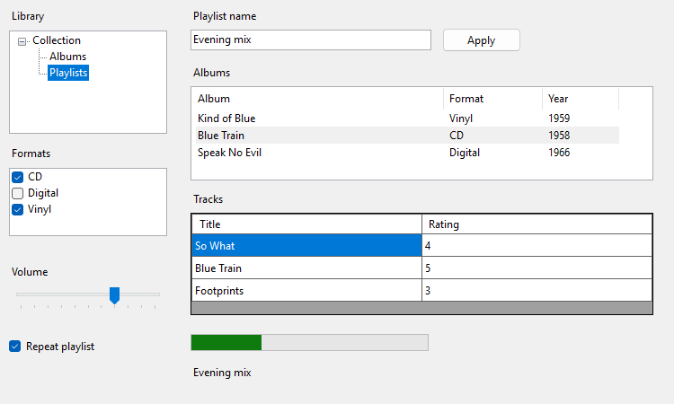
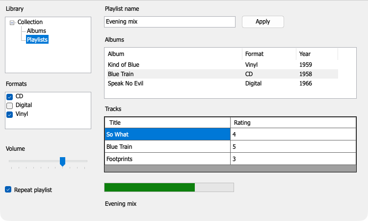

# Record Library benchmark

This ordinary C# WinForms project exercises a split container, a tree, a checked list, a details list with columns, an editable data grid bound to a BindingSource, a text box, buttons, a slider and a progress bar. It uses a local in-memory collection and needs no service or account.

Run it interactively with `dotnet run --project tests/Gallery` on Windows or `./bin/mac-winform run tests/Gallery` on macOS. Select a track, change its rating, edit the playlist name, adjust the volume and press **Apply**.

## Reproduce the comparison

From the repository root, run the stock Windows project on Windows with the .NET 8 Windows Desktop runtime installed.

```powershell
dotnet run --project tests/Gallery -- --probe .\reference
```

The Windows probe draws only its form's client area into `gallery.png` and writes `state.json`. During the probe it selects a tree node and album, checks two formats, changes a slider and checkbox, appends a bound track and presses the Apply button. It returns a failing exit code when those values differ from the expected state.

On macOS run the capture helper from the same checkout. The active terminal needs screen capture permission to capture the gallery window.

```sh
swift tests/Gallery/capture-macos.swift /tmp/record-library-mac
python3 tests/Gallery/compare.py docs/gallery/windows/state.json /tmp/record-library-mac/state.json
```

The helper builds through the public launcher, runs the same probe, selects the window by both process ID and title, and removes its title bar from the capture. The comparison checks all public state values and each reported client-relative rectangle. To compare the pixels at 100% scale, run the following with Pillow installed. The comparison reads unscaled RGB values and composites any transparent Mac window corners onto the form background. The extension has no Pillow dependency.

```sh
python3 tests/Gallery/compare_pixels.py docs/gallery/windows/gallery.png /tmp/record-library-mac/gallery.png
```

## Captured results

| Windows 11, stock Microsoft WinForms | macOS, native compatibility layer |
| --- | --- |
|  |  |

Both captures cover a 750 × 450 client area. The Windows 11 capture used stock SDK 8.0.134 and Windows Desktop runtime 8.0.34 on a private desktop. macOS ran the same source against the compatibility assembly and AppKit. All 12 state values and all 10 measured control rectangles matched.

The following percentages count exact RGB matches against the same Windows 11 capture. They describe this light-theme gallery at 96 DPI. Font rasterization and the progress bar's animation timing still produce visible differences.

| Client region | 0.2.0 | 0.2.1 |
| --- | ---: | ---: |
| Entire client | 81.82% | 95.54% |
| TreeView | 69.07% | 94.12% |
| CheckedListBox | 85.82% | 94.30% |
| TrackBar | 79.08% | 99.85% |
| ListView | 70.87% | 94.24% |
| DataGridView | 54.88% | 97.18% |
